<!-- cSpell:ignore nxttrendz deployement NxtWave colour Mumbai ap-south CIDR sshagent gunicorn Kubernetes usermod corsheaders runserver eipalloc dockerignore -->
# Deploying Your App on AWS

**Session 10, the final session of the deployment course.**

Every command, address and screenshot in this document came from a real run on
2026-09-16. Nothing here is illustrative. Where a number appears, it was
measured.

Screenshots live in `django_deployement_course/workflow/captures/session-10/`
and are named in each step. Architecture diagrams are in the `diagrams/`
folder beside them.

---

## Contents

1. [What we require](#1-what-we-require)
2. [Where we are, and the gap](#2-where-we-are-and-the-gap)
3. [Logging in with SSH](#3-logging-in-with-ssh)
4. [Docker on the server](#4-docker-on-the-server)
5. [Running the stack](#5-running-the-stack)
6. [Security groups](#6-security-groups)
7. [A permanent address](#7-a-permanent-address)
8. [Shipping a fix through the pipeline](#8-shipping-a-fix-through-the-pipeline)
9. [Moving Jenkins into AWS](#9-moving-jenkins-into-aws)
10. [The finished system](#10-the-finished-system)
11. [Hardening checklist](#11-hardening-checklist)
12. [What is still not production](#12-what-is-still-not-production)

---

## 1. What we require

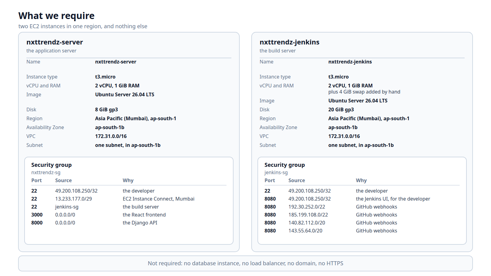

Read this section before touching the console. Everything the session builds is
listed here, with the exact value it will have. Nothing below is decided later.

### 1.1 Why two servers and not one

The application and the build server do different jobs and are sized
differently. Keeping them apart is also what lets the build server reach the
application privately, which section 9 uses.

| | Application server | Build server |
|---|---|---|
| Runs | the React frontend and the Django API | Jenkins |
| Must be reachable by | everyone on the internet | you, and GitHub |
| Fails badly if it stops | yes, the site goes down | no, you just cannot deploy |

### 1.2 The application server, in full

| Setting | Value | Why this value |
|---|---|---|
| Name | `nxttrendz-server` | names the thing it is |
| Instance ID | `i-06031b2ad99f0b796` | assigned by AWS at launch |
| Instance type | **t3.micro** | 2 vCPU, 1 GiB RAM. Free tier eligible, and enough to run two small containers |
| Image | **Ubuntu Server 26.04 LTS**, `ami-01a00762f46d584a1` | the same Linux the course has used throughout |
| Disk | **8 GiB gp3** | holds Ubuntu, Docker and two images with room to spare |
| Region | **Asia Pacific (Mumbai)**, `ap-south-1` | nearest to the room |
| Availability Zone | `ap-south-1b` | one building inside that Region |
| VPC | `vpc-0292256715a0e0ab2`, `172.31.0.0/16` | the account's default private network |
| Subnet | `subnet-0b52b9ce32d8053c0` | the slice of that network this instance sits in |
| Private address | `172.31.7.32` | never changes, never leaves AWS |
| Public address | Elastic IP `13.202.184.214` | section 7 explains why it must be Elastic |
| Key pair | `nxttrendz-key`, RSA, `.pem` | the only way in |
| Security group | `nxttrendz-sg`, `sg-03340990eb18a3456` | the door list |

**Its doors.** Five rules, and each one has to be justifiable out loud.

| Port | Source | Why it is open |
|---|---|---|
| 22 | `49.200.108.250/32` | you, and only you, administer the server |
| 22 | `13.233.177.0/29` | AWS's own browser Connect service in Mumbai |
| 22 | `sg-0a8dd5bcc3a3e91a8` | the build server, named by **security group** and not by address |
| 3000 | `0.0.0.0/0` | the React frontend. Users are the point |
| 8000 | `0.0.0.0/0` | the Django API, which the browser calls directly |
| ~~5432~~ | **no rule** | there is no database server. See 1.4 |

### 1.3 The build server, in full

| Setting | Value | Why this value |
|---|---|---|
| Name | `nxttrendz-jenkins` | |
| Instance ID | `i-0c96a9a3b4803cefc` | |
| Instance type | **t3.micro** | free tier again, **plus 4 GiB of swap added by hand**. See the warning below |
| Image | **Ubuntu Server 26.04 LTS** | same as the app server |
| Disk | **20 GiB gp3** | not 8. Docker builds accumulate layers and images fast |
| Private address | `172.31.15.67` | same VPC as the app server, which is the whole point |
| Public address | `3.108.220.155` | GitHub must be able to reach it |
| Security group | `jenkins-sg`, `sg-0a8dd5bcc3a3e91a8` | |

**Its doors.**

| Port | Source | Why it is open |
|---|---|---|
| 22 | `49.200.108.250/32` | you administer it |
| 8080 | `49.200.108.250/32` | you open the Jenkins interface |
| 8080 | `192.30.252.0/22` | GitHub webhooks |
| 8080 | `185.199.108.0/22` | GitHub webhooks |
| 8080 | `140.82.112.0/20` | GitHub webhooks |
| 8080 | `143.55.64.0/20` | GitHub webhooks |

> **A t3.micro will run Jenkins, and it will not enjoy it.** Measured on this
> instance: 908 MiB of usable RAM, of which Jenkins took 436 MiB while idle,
> leaving 133 MiB free. With 4 GiB of swap attached, 486 MiB of swap was
> already in use before a single build ran. A build completes in about two
> minutes. Budget the wait, or pay for a larger instance.

### 1.4 What we deliberately do not require

- **No database instance.** The Django app keeps its data in a SQLite file
  inside the Docker volume `db_data`, mounted at `/app/data`. There is no
  PostgreSQL container and no port 5432. A database that has no port cannot be
  reached from the internet at all.
- **No load balancer.** One server, one address.
- **No domain name and no HTTPS.** Both are the natural next step and neither
  is in this course. Section 12 says so plainly.

### 1.5 What already exists before this session

| Thing | Where it came from |
|---|---|
| `github.com/jeevan170902/nxttrendz` | the course's app, since session 1 |
| `jeevansravanth/nxttrendz-backend` and `-frontend` on Docker Hub | session 8's pipeline |
| A Jenkins pipeline: Checkout, Build, Push | session 8 |
| An AWS account on the Free plan, and the app server, stopped | session 9 |

---

## 2. Where we are, and the gap

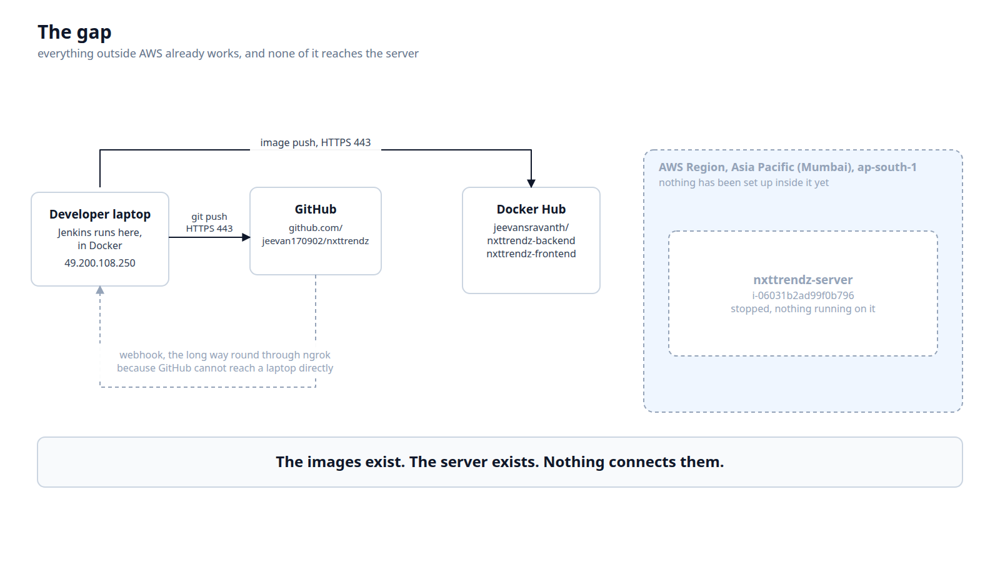

The images are on Docker Hub. The server is on AWS. **Nothing connects them.**
Closing that gap is this session.

### 2.1 Start the instance

Session 9 stopped it, so the first job is to start it.

**Console path:** `EC2 → Instances → select nxttrendz-server → Instance state →
Start instance`

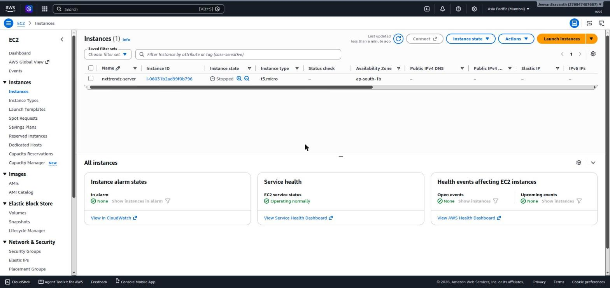

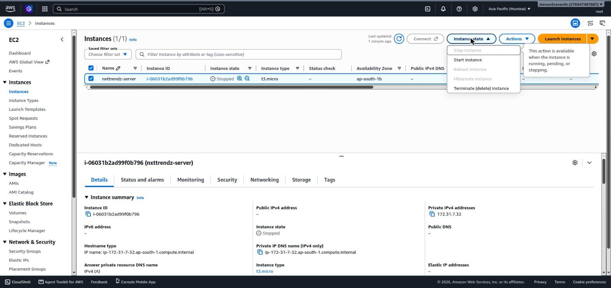

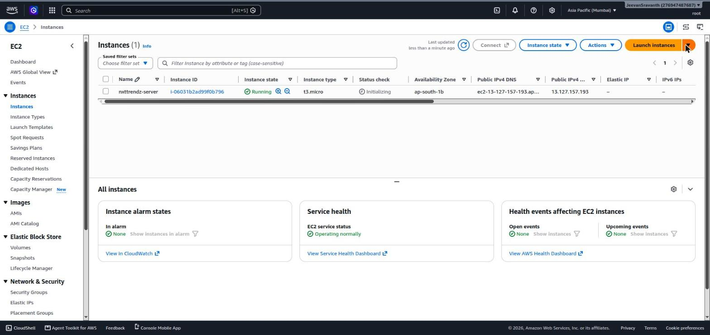

### 2.2 The address changed. Again

The instance came back on `13.127.157.193`. It had been `65.2.153.167` when
session 9 stopped it, and `15.207.88.14` and `13.203.216.68` before that.

**Four addresses, in two sessions.** Note it, do not fix it. Section 7 fixes
it, and by then you will know why it matters more than it looks.

The private address, `172.31.7.32`, has not moved once.

---

## 3. Logging in with SSH

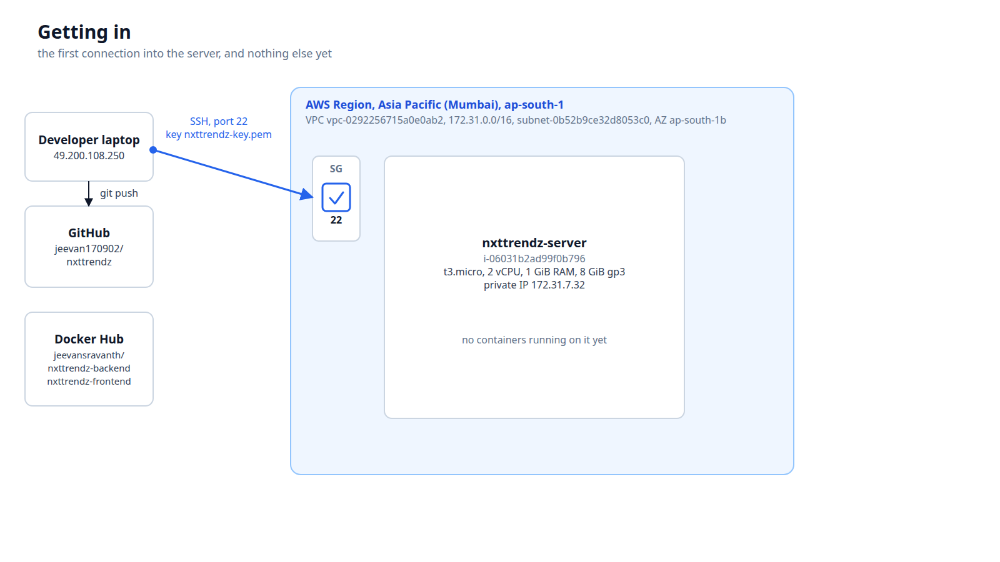

**What this step requires:** the running instance, `nxttrendz-key.pem` on your
machine, and port 22 open from your address. All three are already in place.

### 3.1 SSH, in one line

**SSH** is Secure Shell. You type in your own terminal and the commands run on
the remote machine. It is how every Linux server on earth is administered.

Session 9 used the browser Connect button. That is AWS's convenience. This is
the real way, and it is the one that works from a script.

### 3.2 The error everybody gets first

The `.pem` file downloads with permissions that let other users of your
computer read it, and SSH refuses to use a key in that state.

```bash
ssh -i nxttrendz-key.pem ubuntu@13.127.157.193
```

```
@@@@@@@@@@@@@@@@@@@@@@@@@@@@@@@@@@@@@@@@@@@@@@@@@@@@@@@@@@@
@         WARNING: UNPROTECTED PRIVATE KEY FILE!          @
@@@@@@@@@@@@@@@@@@@@@@@@@@@@@@@@@@@@@@@@@@@@@@@@@@@@@@@@@@@
Permissions 0644 for 'nxttrendz-key.pem' are too open.
It is required that your private key files are NOT accessible by others.
This private key will be ignored.
Load key "nxttrendz-key.pem": bad permissions
ubuntu@13.127.157.193: Permission denied (publickey).
```

The message says exactly what is wrong. Fix it:

```bash
chmod 400 nxttrendz-key.pem
```

`400` means readable by you, and by nobody else. Not writable, not executable,
not readable by your group or anyone else on the machine.

### 3.3 In

```bash
ssh -i nxttrendz-key.pem ubuntu@13.127.157.193
```

```
Welcome to Ubuntu 26.04 LTS (GNU/Linux 7.0.0-1006-aws x86_64)

  System load:  0.14              Processes:             119
  Usage of /:   30.7% of 6.61GB   Users logged in:       0
  Memory usage: 25%               IPv4 address for ens5: 172.31.7.32

Last login: Wed Sep 16 09:29:51 2026 from 49.200.108.250
ubuntu@ip-172-31-7-32:~$
```

Three parts of that command, and one line of output, are worth pausing on.

| Part | Meaning |
|---|---|
| `-i nxttrendz-key.pem` | the identity file, your half of the key pair |
| `ubuntu@` | the default user on an Ubuntu image. Not `root`, and not your own name |
| `13.127.157.193` | the instance's public address |

**The prompt is the proof.** `ubuntu@ip-172-31-7-32` is the private address
from section 1.2, on a machine in a Mumbai data centre. `exit` brings you home.

---

## 4. Docker on the server

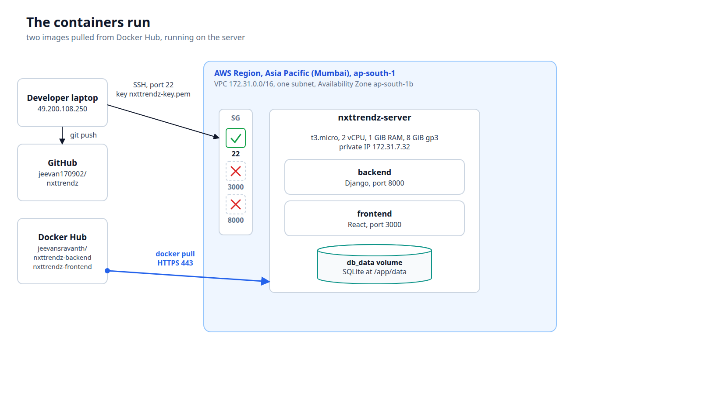

**What this step requires:** an SSH session, and outbound internet from the
instance. Outbound is open by default on every security group, so there is
nothing to configure.

### 4.1 A fresh Ubuntu has nothing

```
ubuntu@ip-172-31-7-32:~$ docker --version
bash: docker: command not found
```

### 4.2 Install it

```bash
sudo apt-get update
sudo apt-get install -y docker.io docker-compose-v2
sudo usermod -aG docker ubuntu
```

| Command | What it does |
|---|---|
| `apt-get update` | refreshes Ubuntu's list of available packages |
| `apt-get install -y docker.io docker-compose-v2` | the Docker engine, and the `docker compose` command |
| `usermod -aG docker ubuntu` | lets the `ubuntu` user run Docker without `sudo` |

**The third one does not take effect until you log out and back in.** Group
membership is read when a session starts. Type `exit`, then SSH in again.

```
ubuntu@ip-172-31-7-32:~$ docker --version
Docker version 29.1.3, build 29.1.3-0ubuntu4.1
ubuntu@ip-172-31-7-32:~$ docker compose version
Docker Compose version 2.40.3+ds1-0ubuntu1
```

### 4.3 Pull the images

This is the moment the Docker Hub session was for.

```bash
docker pull jeevansravanth/nxttrendz-backend:6
docker pull jeevansravanth/nxttrendz-frontend:6
```

```
Status: Downloaded newer image for jeevansravanth/nxttrendz-backend:6
Status: Downloaded newer image for jeevansravanth/nxttrendz-frontend:6

IMAGE                                 DISK USAGE   CONTENT SIZE
jeevansravanth/nxttrendz-backend:6         295MB         69.5MB
jeevansravanth/nxttrendz-frontend:6        607MB          152MB
```

**This server has never seen your source code.** No `git clone`, no build, no
Dockerfile. It downloaded two finished images by name. That is what a registry
is for.

Two things happened quietly and both matter later:

- **No `docker login` was needed**, because the repositories are public.
- **No firewall rule was needed**, because outbound traffic is open by default.
  Section 6 collects that point.

---

## 5. Running the stack

**What this step requires:** both images pulled, and a `docker-compose.yml` and
`.env` written on the server.

### 5.1 One word changes per service

This is session 4's compose file with `build:` replaced by `image:`.

```yaml
services:
  backend:
    image: jeevansravanth/nxttrendz-backend:6
    ports:
      - "8000:8000"
    env_file:
      - .env
    volumes:
      - db_data:/app/data
  frontend:
    image: jeevansravanth/nxttrendz-frontend:6
    ports:
      - "3000:3000"
    environment:
      VITE_API_BASE_URL: http://localhost:8000
    depends_on:
      - backend
volumes:
  db_data:
```

**Why `image:` and not `build:`.** The server's job is to run what the pipeline
built and tested. A server that builds its own copy is running something no
pipeline ever checked, and the two will drift.

### 5.2 The `.env`

On this server it holds one line.

```
SECRET_KEY=<a long random value>
```

That is all. There are no database credentials, because there is no database
server. Do not go looking for `DB_HOST` or `ALLOWED_HOSTS`: this app hardcodes
`ALLOWED_HOSTS = ["*"]` in `settings.py`.

### 5.3 Up

```bash
docker compose up -d
docker compose ps
```

```
NAME                   IMAGE                                 STATUS   PORTS
nxttrendz-backend-1    jeevansravanth/nxttrendz-backend:6    Up       0.0.0.0:8000->8000/tcp
nxttrendz-frontend-1   jeevansravanth/nxttrendz-frontend:6   Up       0.0.0.0:3000->3000/tcp
```

A fresh volume means an empty database, so create the tables:

```bash
docker compose exec backend python manage.py migrate
```

### 5.4 Open it, and watch it fail

```
http://13.127.157.193:3000/
```

Nothing. The browser spins, and after about fifteen seconds:

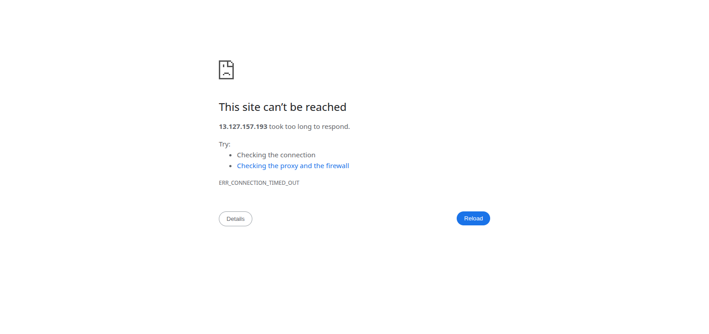

```
This site can't be reached
13.127.157.193 took too long to respond.
ERR_CONNECTION_TIMED_OUT
```

Measured from a terminal, the contrast is sharp:

| Request | Result |
|---|---|
| `curl http://13.127.157.193:8000/api/products/` | **HTTP 200 in 0.073 seconds** |
| `curl http://13.127.157.193:3000/` | **timed out after 15 seconds** |

The containers are running. One port answers instantly and the other never
answers at all. Section 6 explains why, and it is not the app.

---

## 6. Security groups

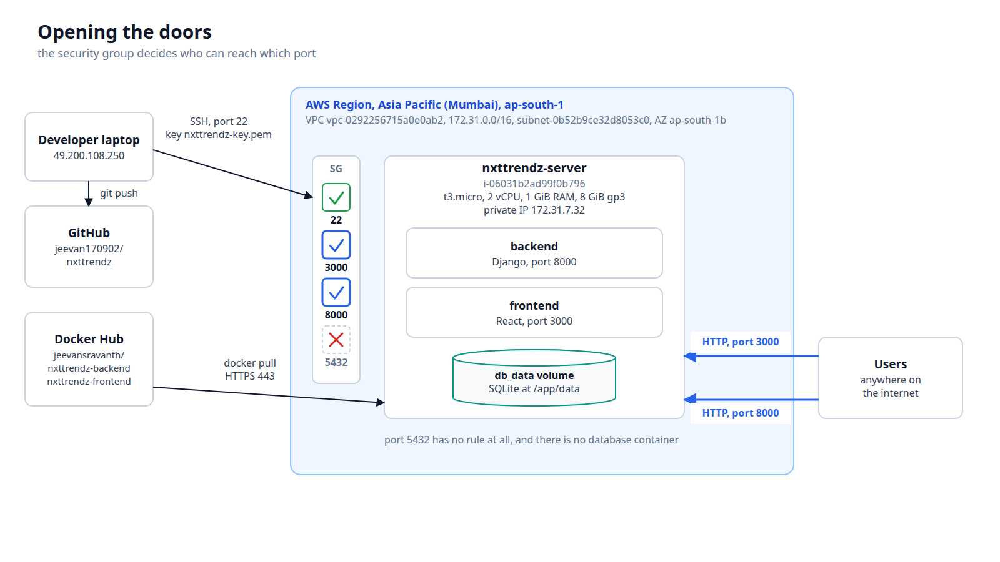

**What this step requires:** nothing new. The fix is a rule, and rules apply
immediately.

### 6.1 What a security group is

A **security group** is a firewall attached to your instance. It is a list of
rules saying which traffic may reach it. Session 9 called it the door list.

Three behaviours define how it thinks.

1. **Default deny, inbound.** With no rules, nothing can connect to anything.
   Every open door is a decision somebody made.
2. **Allow rules only.** There is no "block" rule. You cannot blocklist. You
   choose what is permitted and everything else is already refused.
3. **Outbound is open.** The instance may call out freely, which is exactly why
   `docker pull` worked in section 4.3 without any configuration.

### 6.2 The anatomy of a rule

Every inbound rule answers three questions.

| Type | Port | Source |
|---|---|---|
| which protocol | which door | who may knock |
| SSH | 22 | `49.200.108.250/32` |
| Custom TCP | 3000 | `0.0.0.0/0` |

### 6.3 CIDR, just enough

The Source column uses CIDR notation: an address followed by a slash and a
number.

| Value | Reads as | Use it for |
|---|---|---|
| `0.0.0.0/0` | every address on the internet | public services only |
| `49.200.108.250/32` | exactly this one address | administrative access |

`/32` fixes all 32 bits, so it matches one address. `/0` fixes none, so it
matches all of them. The console's **My IP** option fills in your current
address with `/32` for you.

### 6.4 The rules the server actually had

**Console path:** `EC2 → Security Groups → nxttrendz-sg → Inbound rules`

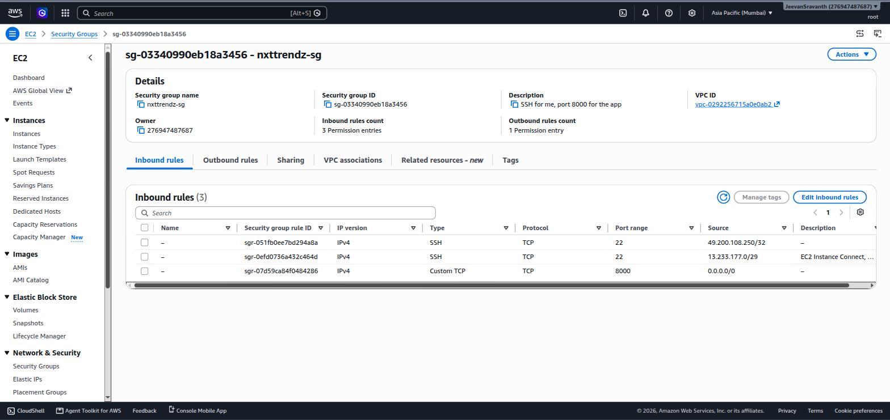

Three rules: SSH from your address, SSH from AWS's Connect range, and 8000 from
anywhere. **Port 3000 is not among them.** That is the entire failure.

### 6.5 Add the rule

**Console path:** `EC2 → Security Groups → nxttrendz-sg → Edit inbound rules →
Add rule`

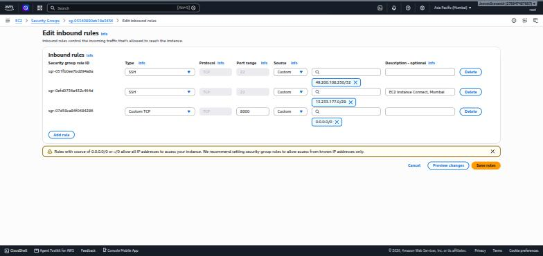

Type **Custom TCP**, port **3000**, source **Anywhere-IPv4**, description
"The React frontend".

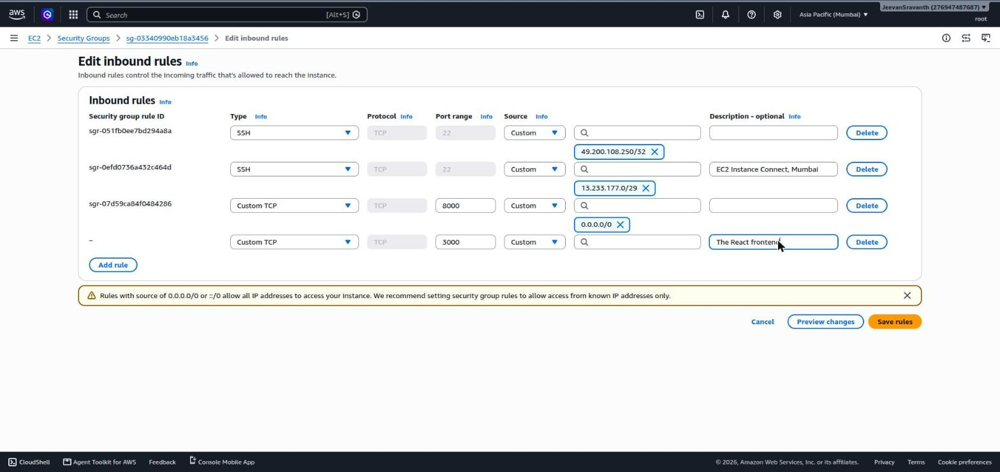

> **A snag worth knowing.** Choosing *Anywhere-IPv4* in the Source dropdown
> does not always fill the source box in, and Save then refuses with
> "CIDR block, a security group ID or a prefix list has to be specified".
> Type `0.0.0.0/0` into the box and pick it from the list.
>
> 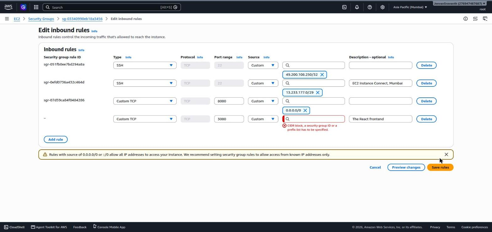

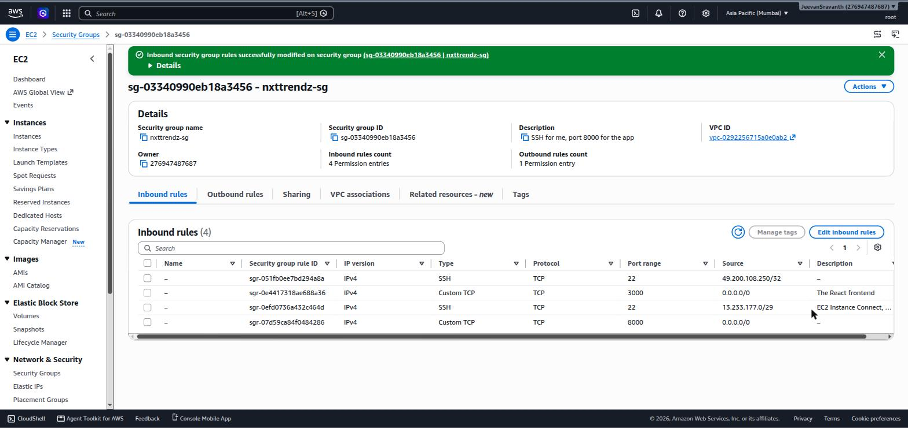

**Rules apply immediately.** No restart, no redeploy. The browser tab that had
been hanging loaded the site while the confirmation banner was still on screen.

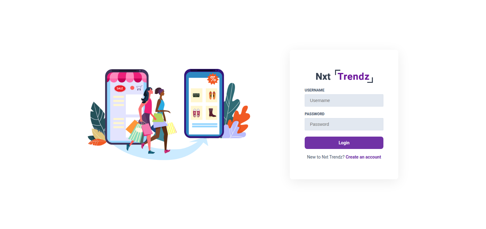

### 6.6 Timeout against refused

Two failures that look similar and mean opposite things. Memorise the pair.

| Symptom | What happened | Where to look |
|---|---|---|
| **Connection timed out**, after a long silence | packets were dropped before reaching the instance | the security group. No rule for that port or source |
| **Connection refused**, instantly | packets arrived, and nothing was listening | the app. Container down, crashed, or the wrong port mapped |

Both appeared in this session. Port 3000 **timed out** because of the firewall.
The login request in section 8 was **refused**, instantly, because it reached a
machine where nothing was listening.

A classic trap the decoder catches: you enabled SSH with *My IP*, then moved
from home to office. SSH now times out, because your address changed and the
`/32` rule still names the old one. Edit the rule, choose *My IP* again.

### 6.7 Justify every door

| Port | Source | Justification |
|---|---|---|
| 22 | your address | only you administer this server |
| 3000 | everywhere | the app. Users are the point |
| 8000 | everywhere | the API, which the browser calls directly |
| 5432 | **no rule** | there is no database server to reach |

**The last row is the most important one.** The data lives in a SQLite file
inside a Docker volume that only the backend container can open. It has no
port, so there is nothing to allow and nothing to get wrong.

> If this app ever swaps SQLite for PostgreSQL, the rule is: **a database port
> never appears in an internet-facing security group.** Bots find exposed
> databases within hours. Do not publish the port in compose, and do not allow
> it in the group. Two layers, both closed.

---

## 7. A permanent address

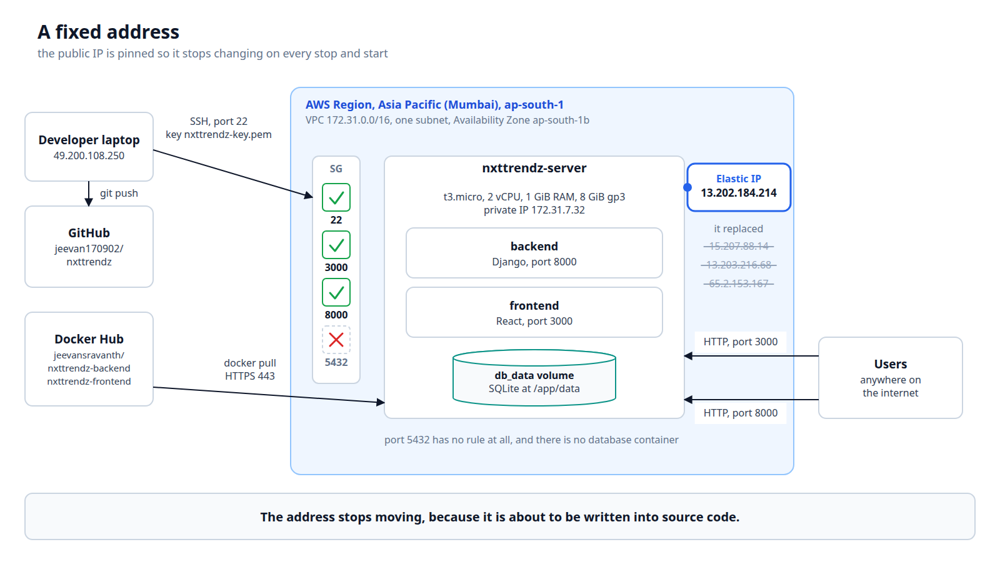

**What this step requires:** one Elastic IP, allocated and then associated with
the instance.

### 7.1 Why not just use the public address AWS gives you

This is the question the room always asks, and it deserves a real answer rather
than "it changes".

It does change. Four times in two sessions:

| When | Address |
|---|---|
| session 9, at launch | `15.207.88.14` |
| session 9, after a restart | `13.203.216.68` |
| session 9, later | `65.2.153.167` |
| session 10, on start | `13.127.157.193` |

But changing is only annoying if the address is something you type. **It is
not.** By the end of this session that address is written down in three places:

1. `VITE_API_BASE_URL` in the compose file on the server
2. `CORS_ALLOWED_ORIGINS` in `settings.py`, **which is inside the Docker image**
3. the host the Jenkins Deploy stage connects to

**The second one settles the argument.** That address is baked into an image
built by the pipeline. Changing it is not an edit. It is a commit, a build, a
push and a redeploy. A free address that moves on every stop would make a full
release the price of every restart.

### 7.2 Allocate it

**Console path:** `EC2 → Elastic IPs → Allocate Elastic IP address → Allocate`

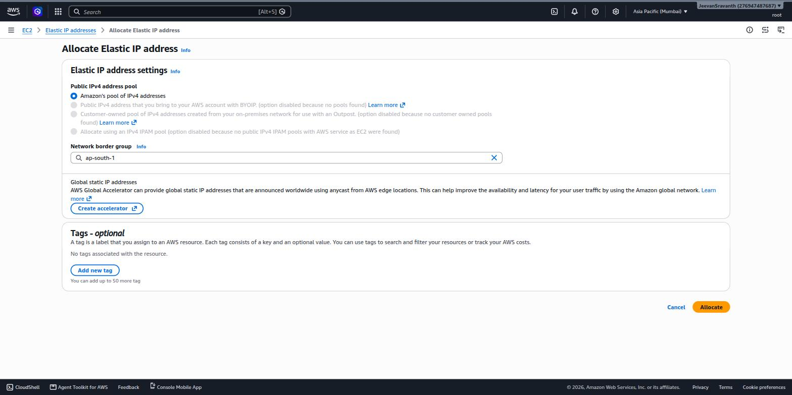

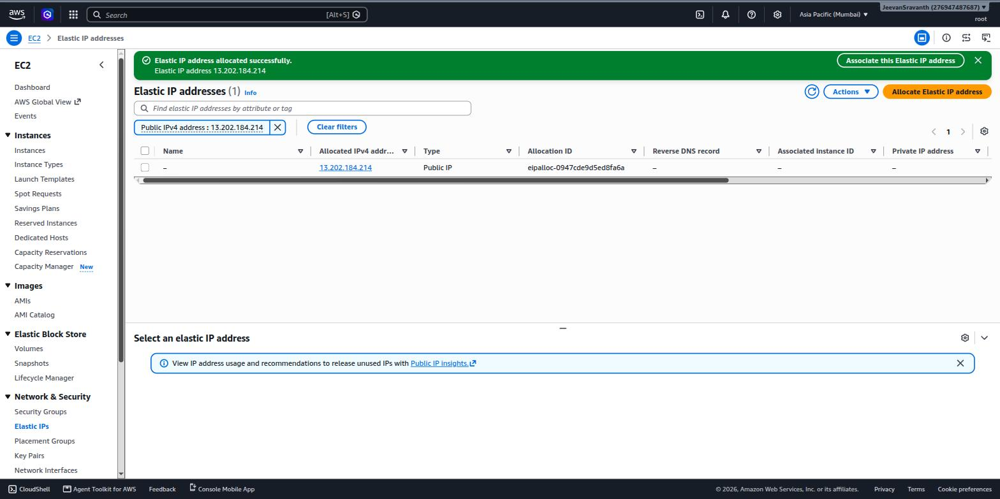

`13.202.184.214` now belongs to the account. Note the **Associated instance ID
column is empty**. That is the state AWS charges for.

### 7.3 Associate it

**Console path:** `Actions → Associate Elastic IP address → choose the instance`

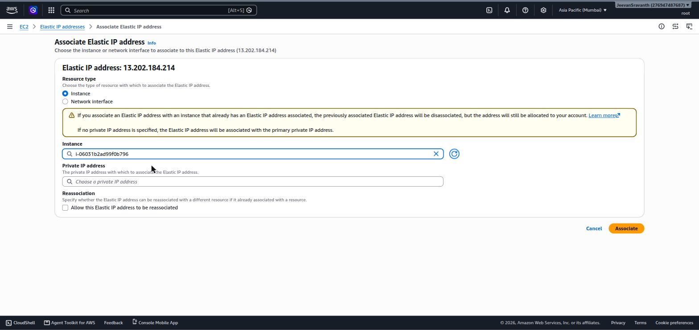

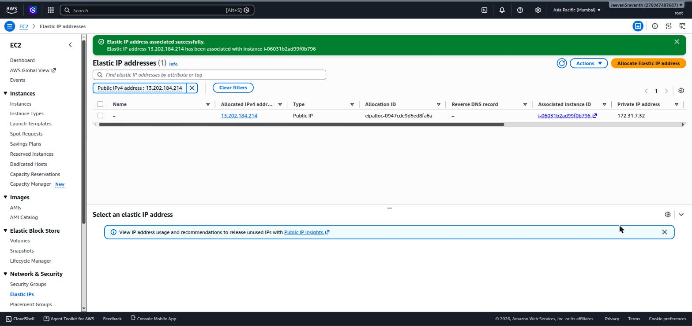

The old address dies the moment the new one attaches. The same command that had
returned `HTTP 200` a minute earlier returned nothing at all.

> **The pricing is deliberately odd.** An Elastic IP attached to a running
> instance is free. One that is allocated and attached to nothing is billed.
> AWS wants addresses used, not hoarded. **Release what you do not need.**

### 7.4 Point the frontend at it

```yaml
    environment:
      VITE_API_BASE_URL: http://13.202.184.214:8000
```

```bash
docker compose up -d
```

---

## 8. Shipping a fix through the pipeline

**What this step requires:** the running app, and the session 8 pipeline.

### 8.1 The site loads and the product list stays empty

Open the site, log in, and nothing happens. The page gives no error. The
browser console does.

First, before the Elastic IP was in place:

```
POST http://localhost:8000/api/users/login/ net::ERR_CONNECTION_REFUSED
```

**The request went to `localhost`.** The frontend runs in the *visitor's*
browser, so `localhost` is the visitor's own laptop, not the server. Note that
this is **refused** and not a timeout: it reached a machine, and nothing was
listening. Section 6.6's decoder, on a real failure.

Fixing `VITE_API_BASE_URL` in section 7.4 sends the request to the right place.
Then the console says something else:

```
Access to fetch at 'http://13.202.184.214:8000/api/users/login/'
from origin 'http://13.202.184.214:3000' has been blocked by CORS policy:
Response to preflight request doesn't pass access control check:
No 'Access-Control-Allow-Origin' header is present on the requested resource.
```

**CORS**, from session 1, the security guard at the gate. The backend's allowed
origin list still names only `http://localhost:3000`.

### 8.2 This one cannot be fixed on the server

```python
CORS_ALLOWED_ORIGINS = [
    "http://localhost:3000",
]
```

That is in `settings.py`, and `settings.py` is **inside the image**. There is
no file on the server to edit. The fix has to go where every change has gone
since session 7: the source.

```python
CORS_ALLOWED_ORIGINS = [
    "http://localhost:3000",
    "http://13.202.184.214:3000",
]
```

```bash
git add backend/myproject/settings.py
git commit -m "Allow the deployed frontend origin through CORS"
git push origin main
```

### 8.3 The pipeline runs, and stops short

The webhook fires. Jenkins checks out, builds both images, pushes them. Tag `7`
appeared on Docker Hub **40 seconds after the push**.

And the site was still broken, because:

```
$ docker compose ps
backend   jeevansravanth/nxttrendz-backend:6
frontend  jeevansravanth/nxttrendz-frontend:6
```

**The server is still running tag 6.** The pipeline automated everything up to
Docker Hub and then a human has to carry the last mile:

```bash
ssh -i nxttrendz-key.pem ubuntu@13.202.184.214
cd ~/nxttrendz
nano docker-compose.yml      # change :6 to :7
docker compose pull
docker compose up -d
```

Now the login returns `200` and the product list fills.


### 8.4 Kill the manual step

Make the tag a variable instead of a hardcoded number. In the compose file on
the server:

```yaml
    image: jeevansravanth/nxttrendz-backend:${IMAGE_TAG}
```

and in `.env` beside it:

```
IMAGE_TAG=7
```

Now a deploy is one line changed, which a script can do. Add a fourth stage to
the Jenkinsfile:

```groovy
stage('Deploy') { steps {
    sshagent(['ec2-ssh-key']) {
        sh '''
            ssh -o StrictHostKeyChecking=no ubuntu@$EC2_HOST "
                cd ~/nxttrendz &&
                sed -i 's/^IMAGE_TAG=.*/IMAGE_TAG=$BUILD_NUMBER/' .env &&
                docker compose pull &&
                docker compose up -d
            "
        '''
    }
} }
```

It needs two things in Jenkins.

- **The SSH Agent plugin**, which provides the `sshagent` step. It is not
  installed by default. `Manage Jenkins → Plugins → Available plugins`, search
  for SSH Agent, install. No restart needed.
- **A credential** of kind *SSH Username with private key*, username `ubuntu`,
  the contents of `nxttrendz-key.pem` pasted whole including the
  `-----BEGIN` and `-----END` lines, and **ID exactly `ec2-ssh-key`**.

> **The ID is not a label, it is the name the pipeline calls.** Leave the ID
> field blank and Jenkins fills it with a random UUID, the Jenkinsfile cannot
> find it, and the stage fails with "Could not find credentials entry". Jenkins
> will not let you edit an ID afterwards, so you delete the credential and add
> it again.

Push any change and watch four stages go green, then reload the site without
touching a terminal.

---

## 9. Moving Jenkins into AWS

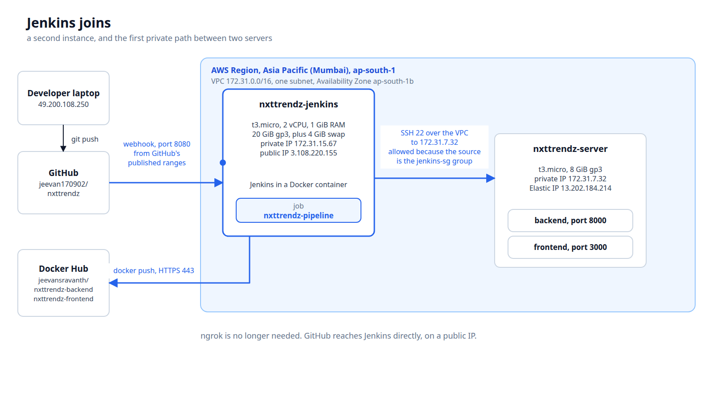

**What this step requires:** a second EC2 instance. The full specification is
in section 1.3, and you should read it again before launching.

### 9.1 Why

Session 8 ran Jenkins on a laptop and needed **ngrok** to let GitHub's webhook
reach it, because a laptop has no public address. That workaround exists only
because of where Jenkins was running.

Put Jenkins on EC2 and it has a public address of its own. **The webhook goes
straight there and ngrok disappears.**

### 9.2 Launch it

**Console path:** `EC2 → Instances → Launch instances`

Name `nxttrendz-jenkins`, Ubuntu 26.04, t3.micro, key pair `nxttrendz-key`.

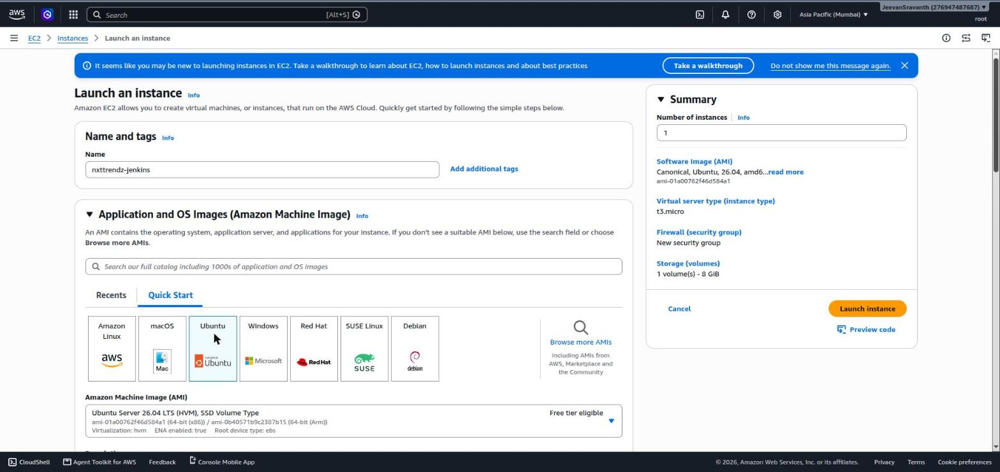

Create a new security group named `jenkins-sg` with **both rules scoped to My
IP**: SSH on 22, and Custom TCP on 8080.

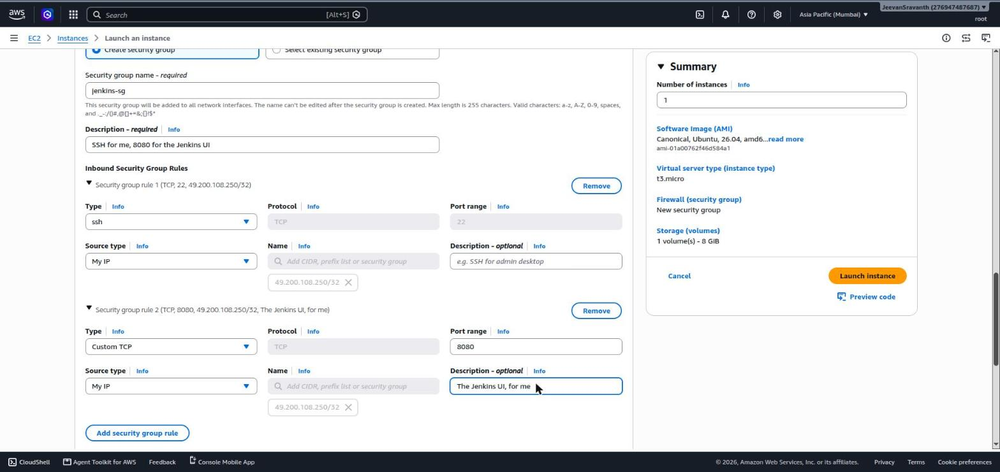

Raise storage from 8 GiB to **20 GiB**.

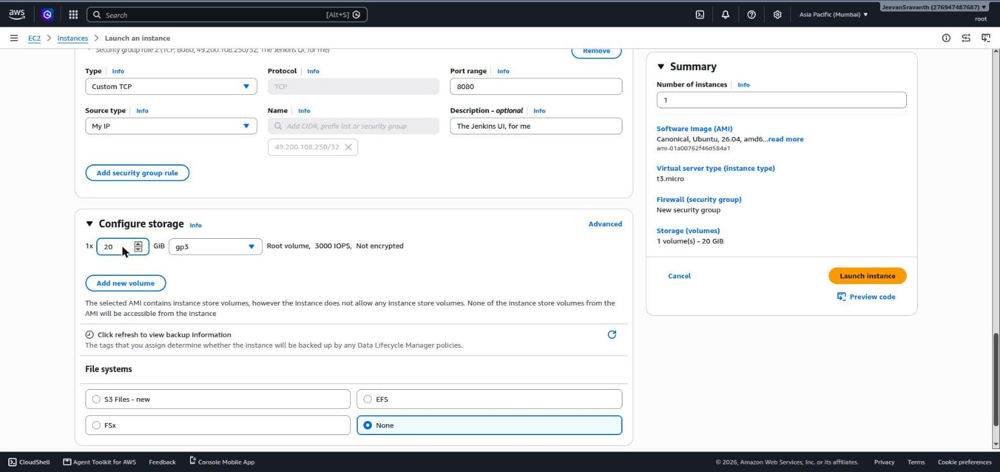

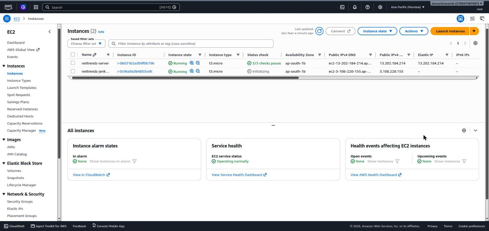

### 9.3 Swap, then Docker, then Jenkins

```bash
sudo fallocate -l 4G /swapfile
sudo chmod 600 /swapfile
sudo mkswap /swapfile
sudo swapon /swapfile
echo '/swapfile none swap sw 0 0' | sudo tee -a /etc/fstab

sudo apt-get update
sudo apt-get install -y docker.io docker-compose-v2
sudo usermod -aG docker ubuntu

sudo docker run -d --name jenkins --restart unless-stopped \
  -p 8080:8080 -p 50000:50000 \
  -v jenkins_home:/var/jenkins_home \
  -v /var/run/docker.sock:/var/run/docker.sock \
  jenkins/jenkins:lts
```

Jenkins builds Docker images, so it needs the Docker CLI inside its own
container and access to the host's socket:

```bash
sudo docker exec -u root jenkins apt-get update
sudo docker exec -u root jenkins apt-get install -y docker.io
sudo docker exec -u root jenkins chmod 666 /var/run/docker.sock
```

### 9.4 Unlock it

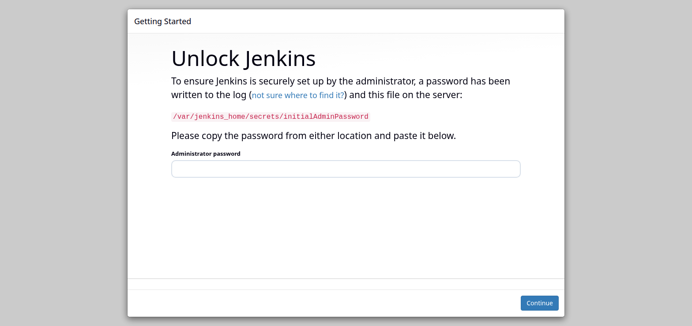

```bash
sudo docker exec jenkins cat /var/jenkins_home/secrets/initialAdminPassword
```

Install suggested plugins, create the admin user, then add the SSH Agent plugin
and both credentials again. **Nothing transfers from the laptop Jenkins.** Its
jobs, plugins and credentials live in its own volume.

| What to recreate | ID it must have |
|---|---|
| Docker Hub token | `dockerhub-credentials` |
| The `.pem` | `ec2-ssh-key` |
| The pipeline job | any name. It is `nxttrendz-pipeline` here |

### 9.5 Let the build server reach the app server privately

Both instances sit in the same VPC, so Jenkins can reach the app server on its
**private** address, `172.31.7.32`. That traffic never touches the internet.

Add one rule to `nxttrendz-sg`, and make its **source a security group** rather
than an address:

**Console path:** `EC2 → Security Groups → nxttrendz-sg → Edit inbound rules →
Add rule`, Type SSH, Source `jenkins-sg`.

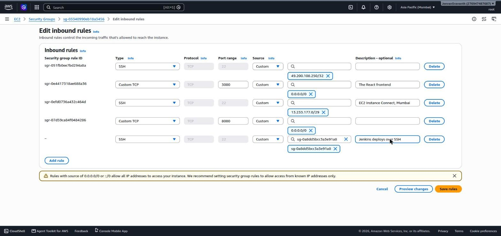

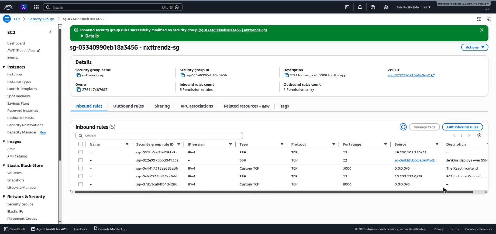

**Why this is better than an address.** Any instance in `jenkins-sg` may
connect. Replace the build server, give it a new address, and nothing needs
re-pinning. No address appears in the rule at all.

Then point the Deploy stage at the private address:

```groovy
EC2_HOST = '172.31.7.32'
```

### 9.6 Let GitHub in

`jenkins-sg` allows 8080 from your address only, so GitHub's delivery would be
dropped. GitHub publishes the addresses its webhooks come from at
`https://api.github.com/meta`, under `hooks`.

Add one rule per range, all on port 8080:

```
192.30.252.0/22
185.199.108.0/22
140.82.112.0/20
143.55.64.0/20
```

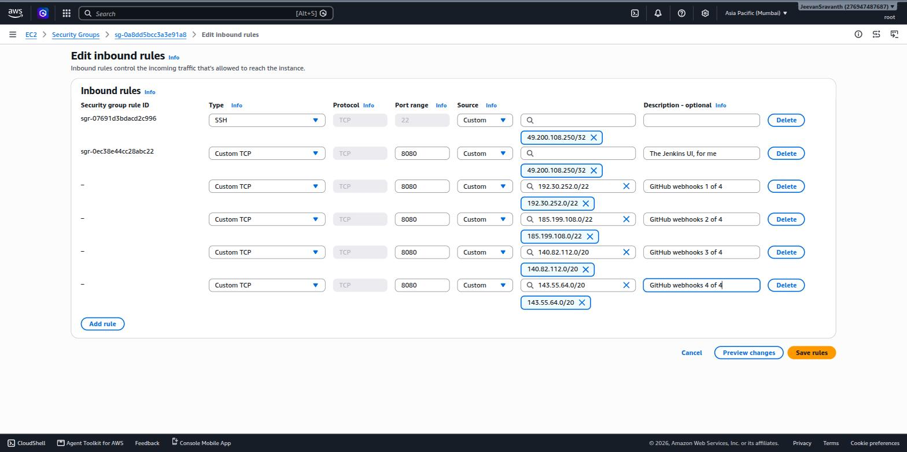

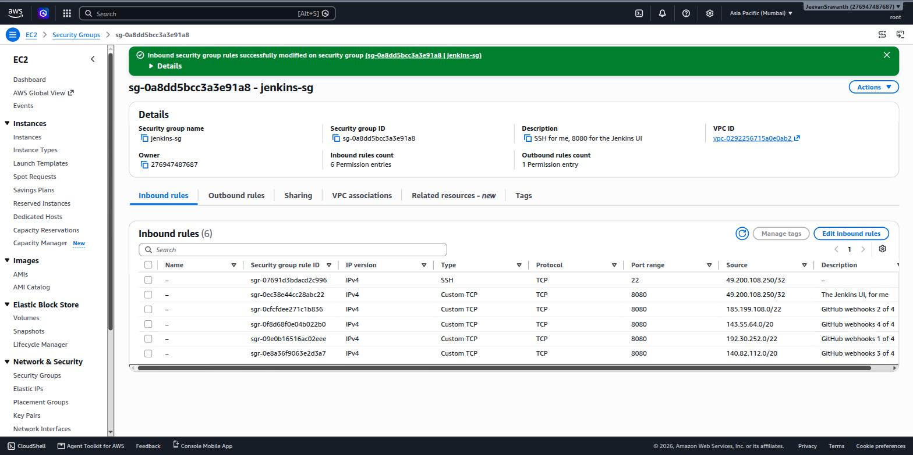

### 9.7 Repoint the webhook

**GitHub path:** `repository → Settings → Webhooks → the hook → Payload URL`

```
http://3.108.220.155:8080/github-webhook/
```

The trailing `/github-webhook/` matters, and so does the trailing slash.

### 9.8 Watch it run

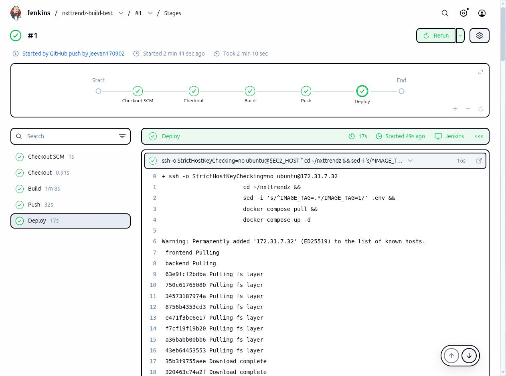

| Stage | Time |
|---|---|
| Checkout SCM | 1s |
| Checkout | 0.91s |
| Build | 1m 8s |
| Push | 32s |
| Deploy | 17s |

```
+ ssh -o StrictHostKeyChecking=no ubuntu@172.31.7.32
      cd ~/nxttrendz &&
      sed -i 's/^IMAGE_TAG=.*/IMAGE_TAG=1/' .env &&
      docker compose pull &&
      docker compose up -d
```

**A private address, and no laptop anywhere in the chain.**

> **Build numbers restart.** A new Jenkins counts from 1, so the deployed image
> is `:1` even though Docker Hub still holds `:4` through `:8` from the laptop.
> Nothing went backwards.

### 9.9 Give the job a name that is true

The job has been called `nxttrendz-build-test` since session 8, and session 8
removed the Test stage. The name has been wrong ever since.

**Console path:** `job → Rename`

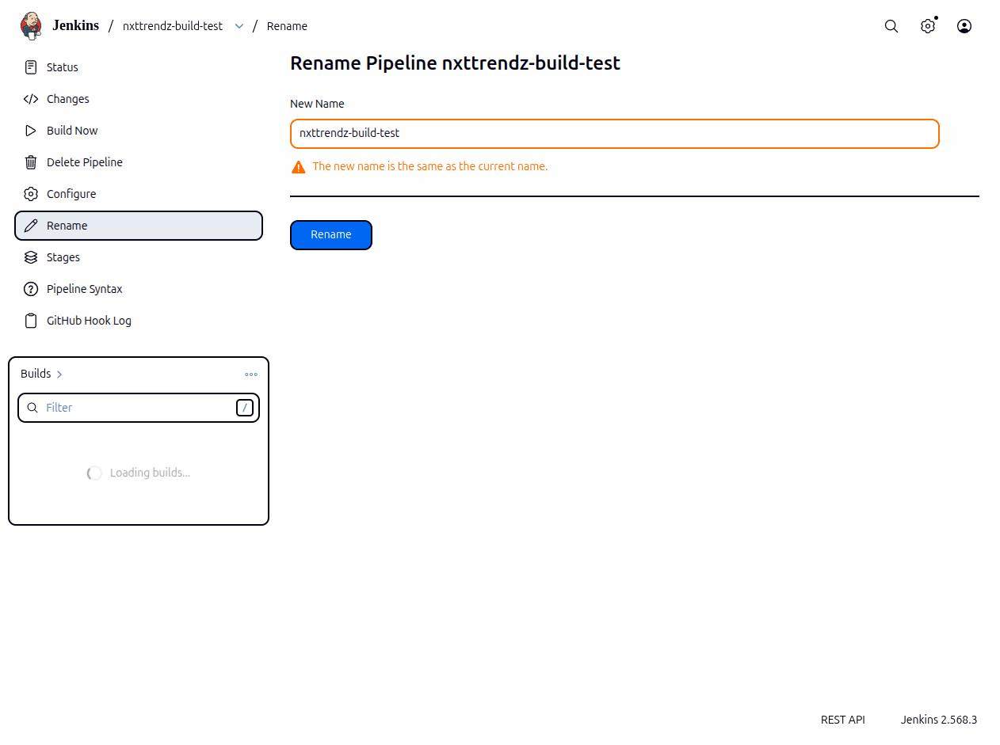

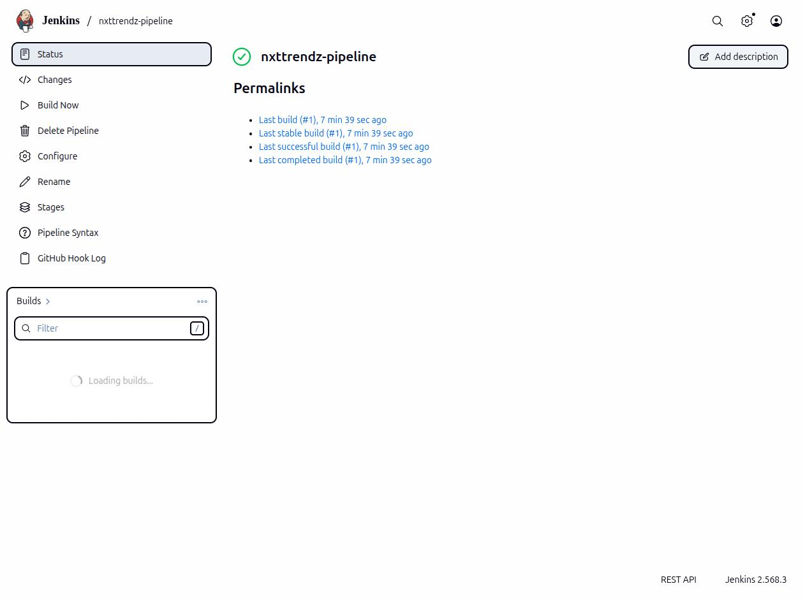

Build history survives, and so does the webhook: GitHub posts to
`/github-webhook/` and Jenkins matches on the repository URL, not the job name.

The hook log proves both the delivery and the rule that allowed it:

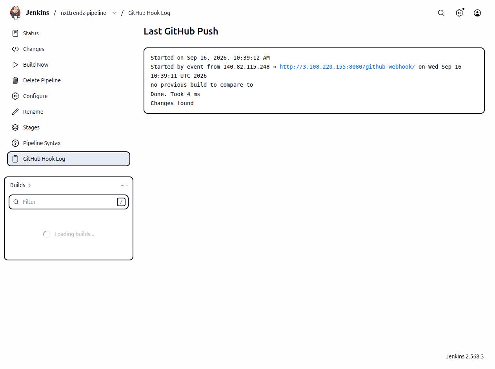

```
Started by event from 140.82.115.248 → http://3.108.220.155:8080/github-webhook/
Done. Took 4 ms
Changes found
```

`140.82.115.248` sits inside `140.82.112.0/20`, one of the four ranges added in
section 9.6.

---

## 10. The finished system

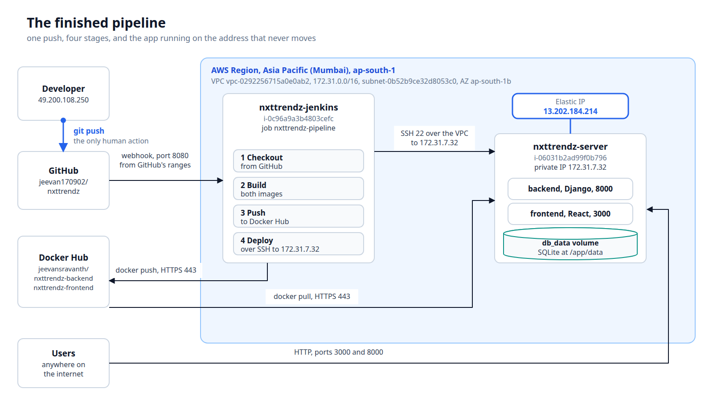

```
DEVELOPER ── git push ─────→ GITHUB            ← the only manual step
                                │ webhook, 8080
                                ▼
                       JENKINS on EC2  (3.108.220.155, jenkins-sg)
                         Checkout → Build → Push → Deploy
                                │                      │
                          push  ▼                      │ ssh 22, private
                          DOCKER HUB                   ▼
                          :1 :4 :6 :7 :8        APP SERVER (172.31.7.32)
                                                  [backend  8000]
                                                  [frontend 3000]
                                                  [db_data volume]
                                                Elastic IP 13.202.184.214
                                                        │
                                                        ▼
                                                      USERS
```

**Continuous Deployment**, the full term from session 7, now earned. A code
change becomes a live release with no human action after `git push`.

### What each layer removed

| Layer | The problem it killed |
|---|---|
| Docker image | "works on my machine" |
| Compose | the multi-container start-up ritual |
| Makefile | long commands and tribal knowledge |
| Docker Hub | images trapped on one machine |
| Jenkins pipeline | forgotten steps and human ritual |
| Webhook | even the button click |
| EC2 | no always-on public machine |
| Security group | reachable by the wrong people |
| Elastic IP | an address that moved under you |
| Jenkins on EC2 | ngrok, and the laptop being part of production |

---

## 11. Hardening checklist

Every line is a discipline this course already taught, applied deliberately.

| # | Item | Taught in |
|---|---|---|
| 1 | SSH restricted to your address, never `0.0.0.0/0` | 10 |
| 2 | The database has no port and no rule | 10 |
| 3 | Key-based SSH only, `.pem` at `chmod 400` | 10 |
| 4 | Secrets in `.env` and the Jenkins credential store, never in Git | 4, 8 |
| 5 | `.dockerignore` keeps `.env` and `.git` out of images | 2, 4 |
| 6 | Machines authenticate with revocable tokens, not passwords | 6, 8 |
| 7 | A unique image tag per build, so any release can be rolled back | 6 |
| 8 | The server runs `image:`, never `build:` | 10 |
| 9 | Server-to-server rules name a security group, not an address | 10 |
| 10 | Elastic IP attached, budget alert set, instances stopped when idle | 9, 10 |

Note how few of these are security tools. Most are ordinary disciplines applied
consistently, which is what most real security actually is.

---

## 12. What is still not production

Say this out loud rather than letting the room assume otherwise.

- **Both servers are development servers.** Django runs `manage.py runserver`
  and the frontend runs the Vite dev server. Production uses gunicorn behind
  nginx, and a built static bundle.
- **`DEBUG = True`.** Turning it off requires handling static files, which is
  its own topic.
- **No HTTPS and no domain.** Traffic is plain HTTP on an IP address.
- **SQLite on one disk.** Fine for a course, not for concurrent writers.
- **One server.** No redundancy. If the instance stops, the site is down.

### Where this leads

Every one of those has a standard answer, and each assumes exactly what you now
have: gunicorn behind nginx instead of `runserver`, a managed database such as
RDS instead of a file, HTTPS and a domain in front of the Elastic IP, a
container orchestrator when one server becomes fifty, and monitoring around all
of it.

You started this course with an app on `localhost`. You are ending it with a
tested, versioned, automatically deployed service on the public internet, and
the vocabulary of every DevOps conversation you will have.

---

## Before you close the laptop

Both instances and the Elastic IP cost money while they exist.

```
EC2 → Instances → select both → Instance state → Stop instance
EC2 → Elastic IPs → select → Actions → Release Elastic IP address
```

An Elastic IP is free while attached to a running instance and **billed once it
is not**, so releasing it is part of shutting down, not an optional tidy-up.
