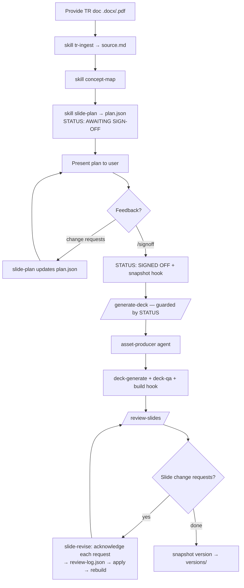
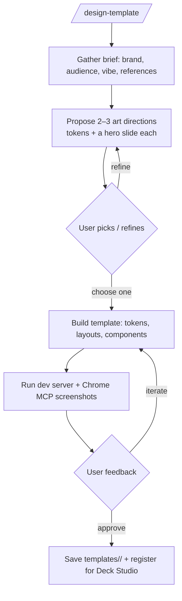
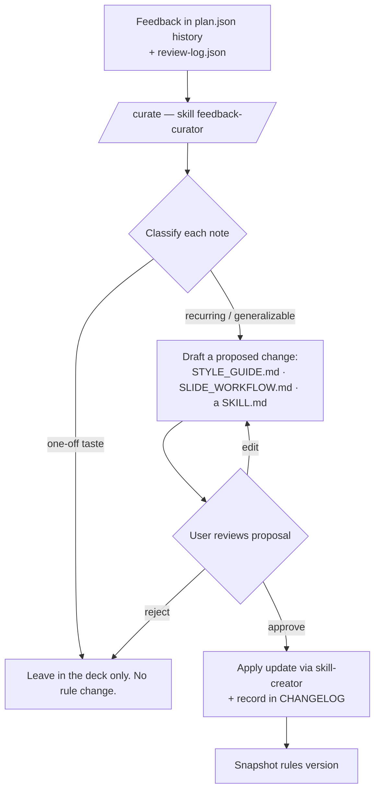

<!-- cSpell:ignore webslides anthropics demoable NxtWave -->
# Web Slides Studio — architecture (built only on Claude Code capabilities)

> **What it is.** A Claude Code plugin that turns any Claude Code session into an interactive
> studio with **two capabilities**:
>
> 1. **Deck Studio** — give it a TR doc → it drafts a slide plan → you review, it revises the
>    plan on your feedback → once you sign off, it generates the deck using skills/subagents →
>    you review slides → it acknowledges and applies your change requests.
> 2. **Template Studio** — design brand-new slide templates through continuous interaction.
>
> **Hard constraint.** Only Claude Code capabilities — skills, plugins, slash commands,
> subagents, hooks, MCP connectors, the GitHub Action, cloud routines. No separate app to build:
> the Claude Code session *is* the application; the conversation is the UI.
>
> This document is the *plan*. It changes no code yet.

---

## 1. The "application" = a Claude Code session running one plugin

Everything ships as one installable plugin, `webslides-studio`, distributed from a plugin
marketplace in the GitHub repo. Install it and any session — local, claude.ai/code, or a cloud
routine — becomes the studio. GitHub is **storage + versioning**, not the trigger.

```
slides-repo/                                  ← GitHub: source of truth + plugin marketplace
├── .claude-plugin/marketplace.json           `/plugin marketplace add` target
├── plugins/webslides-studio/
│   ├── .claude-plugin/plugin.json
│   ├── skills/
│   │   ├── tr-ingest/         (SKILL.md + convert.py)   docx/pdf → clean markdown
│   │   ├── concept-map/       ≤4 key concepts
│   │   ├── slide-plan/        draft + revise plan.json  (the review-loop brain)
│   │   ├── deck-generate/     implement deck from a signed-off plan
│   │   ├── slide-revise/      acknowledge + apply per-slide change requests
│   │   ├── template-design/   Template Studio brain (continuous design loop)
│   │   └── feedback-curator/  learning loop: recurring feedback → guideline/skill updates
│   ├── commands/
│   │   ├── plan-deck.md       start/continue the plan review loop
│   │   ├── signoff.md         record STATUS: SIGNED OFF (opens the generate gate)
│   │   ├── generate-deck.md   guarded: refuses unless plan is signed off
│   │   ├── review-slides.md   collect change requests → slide-revise
│   │   ├── design-template.md enter Template Studio
│   │   └── curate.md          propose guideline/skill updates from accumulated feedback
│   ├── agents/
│   │   ├── asset-producer.md  build SVGs, capture real screenshots (Chrome MCP)
│   │   └── deck-qa.md         adversarial per-slide verifier
│   └── hooks/hooks.json       build-on-change; snapshot-on-signoff/complete
├── template/                                 your Vite + React + TS + Tailwind slide app
├── templates/<name>/                         additional templates from Template Studio
├── workflow/                                 SLIDE_WORKFLOW.md, STYLE_GUIDE.md, this file
└── decks/<course>/<session>/{tr,plan.json,review-log.json,src,dist}
```

`SLIDE_WORKFLOW.md` and `STYLE_GUIDE.md` remain the single brain — every skill points back at them.

---

## 2. Capability A — Deck Studio



Two review loops, both native (the conversation is the loop):

- **Plan loop** — `slide-plan` drafts `plan.json` with `STATUS: AWAITING SIGN-OFF`. It presents,
  you critique, it rewrites. `/signoff` is the only thing that flips status to `SIGNED OFF`.
- **Generation gate** — `/generate-deck` reads `plan.json` and **refuses to run unless
  `STATUS: SIGNED OFF`**. This enforces your existing hard gate mechanically, not by trust.
- **Slide loop** — `/review-slides` gathers your change requests; `slide-revise` first **echoes
  back each request as an acknowledgment** (logged to `review-log.json` with an id + status),
  then applies it, then reports the per-item outcome. Nothing is silently changed or dropped.

---

## 3. Capability B — Template Studio

A separate, design-forward interaction loop that *produces the templates* Deck Studio consumes.



- Driven by `template-design`, delegating to the installed **`frontend-design`, `design-system`,
  `ui-ux-pro-max`, and `slides` skills** — it orchestrates them, it doesn't reinvent them.
- **Continuous interaction** is the whole point: propose → preview → critique → refine, using the
  live dev server + Chrome MCP so you see real renders, not descriptions.
- Output registers into `templates/<name>/`, so `deck-generate` can target any approved template.

---

## 4. Capability C — Feedback → guidelines & skills (the learning loop)

Every note you give in the plan loop and the slide loop is already captured (`plan.json` history
and `review-log.json`). This capability mines that captured feedback and proposes durable upgrades
to the *rules* — so the studio stops repeating mistakes across decks.



- **Taste vs. policy.** `feedback-curator` classifies each note. One-offs stay in the deck.
  Only feedback seen **repeatedly or stated as a general preference** becomes a proposed rule.
- **Where updates land.** Style/visual notes → `STYLE_GUIDE.md`; process/flow notes →
  `SLIDE_WORKFLOW.md`; capability-specific behavior → the relevant `SKILL.md` (edited with the
  `skill-creator` skill).
- **Its own sign-off gate.** Proposals are *presented*, never auto-applied. You approve, edit, or
  reject — the brain is never silently rewritten. Approved changes are logged to a `CHANGELOG`.
- **When it runs.** On demand via `/curate`, or as a **cloud routine** (e.g. weekly) that opens a
  proposal for you to review — the one place async CI fits naturally, since proposals are reviewed
  later, not live.

---

## 5. State model (all in Git, so any session resumes cleanly)

| File | Role |
|---|---|
| `plan.json` | slide-wise plan + `STATUS` (`AWAITING SIGN-OFF` → `SIGNED OFF`). The gate key. |
| `review-log.json` | every slide change request: `{id, slide, request, status, resolved_by}` — the acknowledgment trail |
| `tr/source.md` | converted TR doc (stage-0 output) |
| `versions/<session>.zip` | stage-7 snapshots (written by the snapshot hook) |
| `templates/<name>/` | approved templates from Template Studio |
| `workflow/CHANGELOG.md` | approved rule changes from the learning loop (what changed, why, from which feedback) |

Because state is files in Git, updates are always resumable: reopen the session (local, cloud
routine, or claude.ai/code), and the plugin reads exactly where you left off.

---

## 6. GitHub & CI — the supporting role

- **Storage + versioning + distribution** (the plugin marketplace) — primary role.
- **Optional headless regen** via `claude-code-action`: e.g. a cloud routine that re-runs
  `deck-verify` nightly across open decks. Interactive review still happens in a live session —
  the review loops are deliberately *not* pushed into async CI.

---

## 7. Build order

| Step | Deliverable | Capability used to build it |
|---|---|---|
| 1 | `webslides-studio` plugin skeleton + marketplace.json | `skill-creator` + `/plugin` |
| 2 | `tr-ingest` skill (bundles `convert.py`) | `skill-creator` |
| 3 | `concept-map` + `slide-plan` skills; `plan.json` + `/signoff` + the gate | `skill-creator` |
| 4 | Plan review loop working end-to-end (draft → revise → sign off) — **demo A partial** | above |
| 5 | `deck-generate` skill + `asset-producer`/`deck-qa` agents + build/snapshot hooks | skills, subagents, hooks |
| 6 | `review-slides` + `slide-revise` with the acknowledgment protocol — **demo A full** | skills + commands |
| 7 | `template-design` skill + `/design-template` — **demo B** | skills (delegating to design skills) |
| 8 | `feedback-curator` skill + `/curate` + `CHANGELOG` — **demo C (learning loop)** | `skill-creator` (to edit skills/guidelines) |

Steps 1–4 give you a working, reviewable plan loop before any deck code exists — the fastest path
to something you can try.

---

## 8. Open decisions (defer until we build)

- **Sign-off signal:** is `/signoff` the only path, or also a recognized phrase in chat?
- **Change-request intake:** free-form in chat vs. a structured list `/review-slides` prompts for.
- **Template ↔ deck coupling:** does a deck pin a template version, or always track latest?
- **Screenshot capture:** Chrome MCP needs a real browser — fine interactively, awkward headless.
- **Learning-loop threshold:** how many times must a note recur before it's proposed as a rule
  (e.g. seen in ≥2 decks), and does `/curate` run on demand, on a routine, or both?
